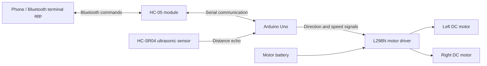
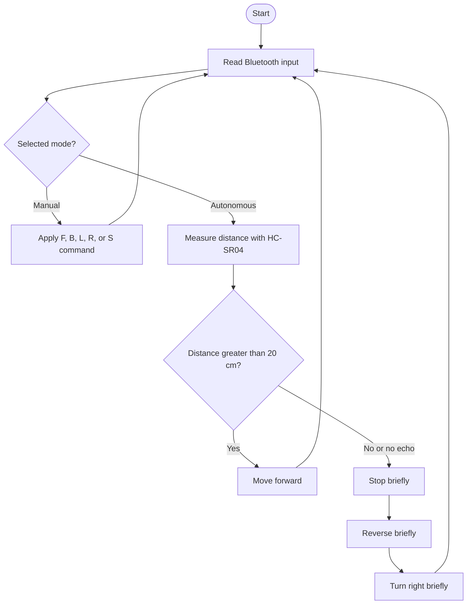

# Obstacle-Avoiding Robot Using Arduino Uno

A third-semester academic project that combines ultrasonic obstacle detection with Bluetooth-based wireless control. The robot can be controlled manually from a phone or switched to autonomous obstacle-avoidance mode.

> **Hardware assumption:** This README and the pin map below match the example sketch shared with this project: Arduino Uno, HC-SR04 ultrasonic sensor, L298N motor driver, and HC-05 Bluetooth module. Update the pin map and component list if your build uses different parts or wiring.

## Project Overview

In autonomous mode, the Arduino reads distance measurements from the HC-SR04. If an obstacle is closer than the configured safe distance, the robot stops, reverses briefly, and turns right. In manual mode, a phone sends single-character commands over Bluetooth to control the motors.

## Features

- Ultrasonic distance measurement for obstacle detection
- Autonomous forward movement and basic obstacle-avoidance maneuver
- Bluetooth manual control from a phone
- Forward, reverse, left, right, and stop commands
- Arduino Uno controls the motors through an L298N driver

## System Block Diagram

## Obstacle-Avoidance Logic

## Hardware Components

| Component | Purpose |
|---|---|
| Arduino Uno | Reads the sensor and controls the robot |
| HC-SR04 ultrasonic sensor | Measures distance to nearby obstacles |
| L298N motor driver | Drives the left and right DC motors |
| HC-05 Bluetooth module | Receives commands wirelessly from a phone |
| Two DC geared motors and wheels | Move the robot |
| Robot chassis | Holds the electronics and motors |
| Battery pack | Supplies power to the motors and driver |
| Jumper wires and switch | Connections and power control |

## Wiring / Pin Map

### HC-SR04 to Arduino Uno

| HC-SR04 pin | Arduino Uno pin |
|---|---|
| VCC | 5V |
| GND | GND |
| TRIG | D12 |
| ECHO | D11 |

### HC-05 to Arduino Uno

| HC-05 pin | Arduino Uno pin |
|---|---|
| TXD | D2 (SoftwareSerial RX) |
| RXD | D3 (SoftwareSerial TX), through a voltage divider |
| VCC | Follow the breakout board's input-voltage specification |
| GND | GND |

### L298N to Arduino Uno and motors

| L298N pin | Arduino Uno / connection |
|---|---|
| ENA | D5 (PWM, left motor speed) |
| IN1 | D7 |
| IN2 | D8 |
| ENB | D6 (PWM, right motor speed) |
| IN3 | D9 |
| IN4 | D10 |
| OUT1 / OUT2 | Left DC motor |
| OUT3 / OUT4 | Right DC motor |
| GND | Common ground with Arduino and battery |
| Motor supply input | Battery positive, within the driver's rating |

> **Important:** Connect the battery, L298N, and Arduino grounds together. Do not power the DC motors from the Arduino 5V pin. HC-05 RX is not generally 5V tolerant; use a voltage divider on the Arduino-to-HC-05 signal. Check the labels and voltage requirements of your exact modules before powering them.

## Bluetooth Controls

Pair the phone with the HC-05, open a Bluetooth serial terminal, and send one character at a time at **9600 baud**.

| Command | Action |
|---|---|
| `F` | Forward |
| `B` | Backward |
| `L` | Turn left |
| `R` | Turn right |
| `S` | Stop |
| `A` | Enable autonomous obstacle-avoidance mode |
| `M` | Return to manual mode |

The example sketch starts in manual mode. Sending a movement command also selects manual mode.

## Setup and Upload

1. Assemble the chassis, motors, sensor, driver, and Bluetooth module.
2. Wire the modules using the pin map above, or update the sketch to match your wiring.
3. Open the Arduino sketch (`.ino`) in the Arduino IDE.
4. Select **Arduino Uno** and the correct serial port.
5. Upload the sketch.
6. Pair your phone with the HC-05 and use a Bluetooth serial terminal to send the commands above.
7. Test the robot with its wheels raised first, then try it on a clear, flat surface.

## Adjustments

- Change `SAFE_DISTANCE_CM` in the sketch to adjust the obstacle threshold.
- Change `MOTOR_SPEED` to adjust motor speed (0-255).
- Adjust the reverse and turn delay values to suit the robot's motors and chassis.
- If a motor spins in the wrong direction, swap that motor's wires or change its direction logic in the sketch.

## Repository Contents

Add the Arduino sketch (`.ino`) to this repository. Photos of the finished robot, a wiring photo or diagram, and a short demonstration video can also help others reproduce the project.

## Project Information

- **Project:** Obstacle-Avoiding Robot Using Arduino Uno
- **Course stage:** Third semester
- **Platform:** Arduino Uno
- **Main topics:** Embedded systems, ultrasonic sensing, motor control, and Bluetooth serial communication
